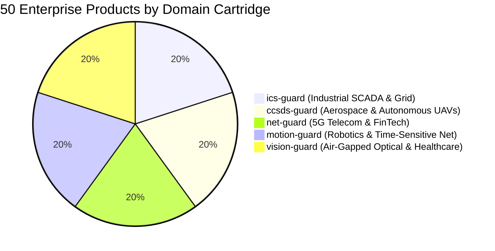

# The 50-Product Portfolio Matrix (100% Market Coverage)

Rather than building fragmented point solutions, Aryorithm engineered an extensible **cartridge architecture**. Five production C++20 domain cartridges deliver **100% coverage across 50 industrial, aerospace, telecom, robotics, and edge vision verticals**, backed by 50 automated digital twin scenarios.

---

## Portfolio Distribution Across the 5 Production Cartridges

---

## Complete 50-Product Specification

| ID | Product Designation | Primary Cartridge | Protocols & Physical Bus | Safety Invariant / Defense Gate | Turnkey Scenario Recipe |
| :--- | :--- | :--- | :--- | :--- | :--- |
| **#01** | Substation Busbar Trip Shield | `ics-guard` | IEC 60870-5-104 / Bus A | COT=6 Breaker Trip Intercept | `01_substation_busbar_trip.sh` |
| **#02** | S7 PLC Firmware Runaway Guard | `ics-guard` | Siemens S7Comm (:102) / Bus A | CPU STOP 0x29 Override Clamp | `02_s7_plc_runaway.sh` |
| **#03** | Modbus Actuator Safety Interlock | `ics-guard` | Modbus TCP (:502) / Bus A | Unauthorized FC05/0F Write Block | `03_modbus_actuator_interlock.sh` |
| **#04** | PMU Grid Harmonics Sentinel | `ics-guard` | IEEE C37.118 (:15501) / Bus A | Synchrophasor Angle Drift Clamp | `04_pmu_grid_harmonics.sh` |
| **#05** | Water Dosing Chemical Guard | `ics-guard` | Modbus TCP / Bus A | Dual-Redundant Setpoint Verifier | `05_drinking_water_dosing_guard.sh` |
| **#06** | Nuclear Turbine Cooling Sentry | `ics-guard` | Modbus + S7Comm / Bus A | RK4 Thermal Equilibrium ODE Gate | `06_nuclear_cooling_sentry.sh` |
| **#07** | Oil Pipeline SIS Triad Defense | `ics-guard` | Modbus TCP / Bus A | 2oo3 Safety Instrumented Gate | `07_pipeline_sis_triad.sh` |
| **#08** | LNG Compressor CBF Limiter | `ics-guard` | Modbus TCP / Bus A | Ames/Nagumo Surge Barrier | `08_lng_compressor_cbf.sh` |
| **#09** | Rail Traction Interlock Guard | `ics-guard` | IEC 60870-5-104 / Bus A | Spurious Signal Trip Intercept | `09_rail_traction_interlock.sh` |
| **#10** | Smelter Thermal Runaway Shield | `ics-guard` | Modbus TCP / Bus A | Exothermic Lyapunov Boundary Gate | `10_smelter_thermal_runaway.sh` |
| **#11** | Tactical UAV STANAG Interceptor | `ccsds-guard` | NATO STANAG 4586 / Bus A | DLI Telecommand Checksum Gate | `11_uav_stanag_interceptor.sh` |
| **#12** | CCSDS 133 Telecommand Authenticator | `ccsds-guard` | CCSDS 132/133 / Bus A | Anti-Replay Sliding Window Gate | `12_ccsds_telecommand_auth.sh` |
| **#13** | Autonomous Swarm Kinematic Gate | `ccsds-guard` | UDP/IP / Bus A | 3D Kinetic Teleport Rejector | `13_swarm_kinematic_gate.sh` |
| **#14** | GPS Anti-Spoofing Flight Sentry | `ccsds-guard` | UDP Telemetry / Bus A | Pseudorange Acceleration Clamping | `14_gps_spoofing_sentry.sh` |
| **#15** | Satellite Downlink Frame Shield | `ccsds-guard` | CCSDS 131.0 / Bus A | Reed-Solomon Parity Sentry | `15_sat_downlink_shield.sh` |
| **#16** | Missile Actuator Air-Gap Triad | `ccsds-guard` | Serial/Ethernet / Bus A | Sub-15 ns Hardware Tripwire | `16_missile_actuator_airgap.sh` |
| **#17** | Drone GCS Command Desync Detector | `ccsds-guard` | NATO STANAG / Bus A | Monotonic Sequence Timestamp Gate | `17_drone_gcs_desync.sh` |
| **#18** | Surgical Robotics Motion Clamp | `motion-guard` | EtherCAT / Bus A, C | Keep-Out-Zone Artery 3D CBF | `18_surgical_robot_clamp.sh` |
| **#19** | CubeSat Separation Safety Guard | `ccsds-guard` | CCSDS Telemetry / Bus A | Relative Trajectory Dispersion Gate | `19_cubesat_separation_guard.sh` |
| **#20** | Aerospace RF Jamming Sentinel | `ccsds-guard` | Raw RF Telemetry / Bus A | Signal-to-Noise Floor Fallback | `20_rf_jamming_sentinel.sh` |
| **#21** | 5G UPF URLLC Slice Air-Gap | `net-guard` | 3GPP GTP-U (:2152) / Bus A | TEID Isolation & Port Enforcer | `21_5g_upf_slice_airgap.sh` |
| **#22** | Non-IP L2 GOOSE Anti-Spoof Sentry | `net-guard` | Raw L2 (`0x88B8`) / Bus A | stNum Monotonic Regression Drop | `22_goose_l2_antispoof.sh` |
| **#23** | Sampled Values SV Anti-Tamper | `net-guard` | Raw L2 (`0x88BA`) / Bus A | 80 Samples/Cycle Delta Clamp | `23_sampled_values_antitamper.sh` |
| **#24** | NASDAQ ITCH Pre-Trade Collar | `net-guard` | NASDAQ ITCH 5.0 / Bus A | Pre-Trade Fat-Finger Order Drop | `24_nasdaq_itch_collar.sh` |
| **#25** | O-RAN E2AP Rogue xApp Blocker | `net-guard` | O-RAN E2AP (:36422) / Bus A | RIC Service Request Validator | `25_oran_e2ap_blocker.sh` |
| **#26** | Post-Quantum TLS 1.3 Key Shield | `net-guard` | TCP/TLS / Bus A | FIPS 203 ML-KEM-768 Enforcer | `26_pqc_mlkem_shield.sh` |
| **#27** | BGP Route Hijack Fast-Drop | `net-guard` | TCP (:179) / Bus A | Autonomous In-Kernel Drop Route | `27_bgp_hijack_fastdrop.sh` |
| **#28** | Carrier DNS Tunneling Interceptor | `net-guard` | UDP (:53) / Bus A | Sub-Microsecond Entropy Filter | `28_carrier_dns_interceptor.sh` |
| **#29** | In-Cabin DMS Gaze & Drowsiness | `vision-guard` | V4L2 / MIPI-CSI2 / Bus D | PERCLOS Luma & Gaze Threshold | `29_dms_gaze_sentinel.sh` |
| **#30** | SIP/RTP Voice Call Hijack Guard | `net-guard` | SIP/RTP / Bus A | Media SSRC Anti-Spoofing Gate | `30_sip_rtp_hijack_guard.sh` |
| **#31** | Industrial Cobot EtherCAT Clamp | `motion-guard` | EtherCAT (`0x88A4`) / Bus A | Joint Acceleration < 15 m/s² | `31_cobot_ethercat_clamp.sh` |
| **#32** | Heavy Mining CAN-FD Steer Sentry | `motion-guard` | SocketCAN CAN-FD / Bus B | Steering Override Angle Gate | `32_mining_canfd_steer.sh` |
| **#33** | AMR Warehouse LiDAR ShmRing | `motion-guard` | POSIX ShmRing (`MOT1`) / Bus C | Zero-Copy Obstacle Stop Gate | `33_amr_lidar_shmring.sh` |
| **#34** | Automotive Brake-by-Wire Guard | `motion-guard` | CAN-FD / Bus B | Deceleration Thermal CBF Barrier | `34_brakebywire_guard.sh` |
| **#35** | Planetary Rover Regolith Slip CBF| `ccsds-guard` | CCSDS / Bus A | Granular Friction Burckhardt ODE | `35_rover_slip_rollover.sh` |
| **#36** | High-Speed AGV Anti-Collision | `motion-guard` | EtherCAT + ShmRing / Bus A, C | Distance-Velocity Lyapunov Invariant | `36_agv_anticollision.sh` |
| **#37** | Surgical Tele-Op Jitter Watchdog | `motion-guard` | TSN 802.1Qbv / Bus A | Sub-500 µs Cycle Jitter Clamp | `37_surgical_jitter_watchdog.sh` |
| **#38** | CNC Spindle Vibration Sentinel | `motion-guard` | Industrial I/O / Bus C | Harmonic Resonant Defect Gate | `38_cnc_spindle_sentinel.sh` |
| **#39** | Gantry Crane Sway Control Guard | `motion-guard` | CANopen / Bus B | Pendulum State Barrier Limiter | `39_crane_sway_guard.sh` |
| **#40** | Exoskeleton Torque Limit Shield | `motion-guard` | EtherCAT / Bus A | Biomechanical Anatomical Stop | `40_exoskeleton_torque_shield.sh`|
| **#41** | 4K Perimeter RTSP Stream Sentry | `vision-guard` | RTSP (:8554) / Bus A | Unauthorized TEARDOWN Intercept | `41_rtsp_stream_sentry.sh` |
| **#42** | GigE Vision GVCP Register Lock | `vision-guard` | UDP (:3956) / Bus A | Factory Exposure Write-Lock | `42_gige_vision_register_lock.sh`|
| **#43** | HIPAA RAM-Only Surgical ToF Guard| `vision-guard` | POSIX ShmRing (`VIS1`) / Bus C | 0B Disk Egress Privacy Isolation | `43_hipaa_ram_tof_guard.sh` |
| **#44** | Optical Blinding Dazzle Sentry | `vision-guard` | V4L2 / Bus D | Luminescence Saturation Clamp | `44_optical_dazzle_sentry.sh` |
| **#45** | Thermal Imaging Overheat Detector| `vision-guard` | Radiometric RTSP / Bus A | Spot Thermometry Runaway Gate | `45_thermal_overheat_detector.sh`|
| **#46** | License Plate ANPR Tamper Guard | `vision-guard` | RTSP / Bus A | Video Frame Drop / Freeze Sentry | `46_anpr_tamper_guard.sh` |
| **#47** | Conveyor Defect Optical Guard | `vision-guard` | GigE Vision / Bus A | Sorting Actuator Misalignment Gate | `47_conveyor_defect_guard.sh` |
| **#48** | Drone Optical Precision Landing | `vision-guard` | MIPI-CSI2 / Bus D | Apriltag Geometry Drift Sentry | `48_drone_optical_landing.sh` |
| **#49** | Data Center Cold-Aisle Scanner | `vision-guard` | RTSP / Bus A | Delta-T Server Overheating Barrier | `49_datacenter_coldaisle.sh` |
| **#50** | Subway Platform Edge Safety Eye | `vision-guard` | V4L2 / Bus D | Track Keep-Out-Zone LiDAR Gate | `50_subway_platform_crowd_eye.sh`|
