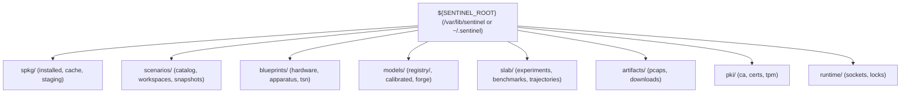

# The Sovereign Sentinel Filesystem (SSFS) Architecture

The **Sovereign Sentinel Filesystem (SSFS)**, implemented in **Tier 0 `sentinel-fs`**, permanently decouples dynamic runtime artifacts from git repository trees.

---

## 1. Privilege-Aware Root Anchor Resolution

All binaries (`aryo`, `sentinel`, `sentinel-ctl`, `sentinel-nexus`) and Python tools (`scenario_engine.py`, `fetch_scenario_assets.py`) resolve storage paths through `sentinel::fs::PathResolver` using strict precedence:

1. **Explicit Argument Override:** `--sentinel-root <path>`
2. **Environment Variable:** `export SENTINEL_ROOT="<path>"`
3. **Privilege Detection:**
   * **System Daemon Mode (`UID == 0` / Root):** `/var/lib/sentinel`
   * **User Mode (`UID != 0` / Non-Root):** `${HOME}/.sentinel`

---

## 2. The 7 Primary Artifact Classes (SSFS Topology)

---

## 3. Content-Addressable Storage (CAS) Deduplication

Heavy binary assets (such as multi-megabyte PCAPs and ONNX weight tensors) are never duplicated across scenario directories. When `fetch_scenario_assets.py` or `models_downloader.sh` retrieves an asset:

1. `CasStore` computes its OpenSSL EVP SHA-256 digest with zero memory copies.
2. The file is committed to `${SENTINEL_ROOT}/models/registry/<sha256>` or `${SENTINEL_ROOT}/artifacts/pcaps/<sha256>`.
3. Active scenario staging areas create POSIX hardlinks (`link_or_copy()`) pointing to the CAS store. If two scenarios use identical 50 MB PCAP baselines, disk consumption is exactly 50 MB, not 100 MB.
