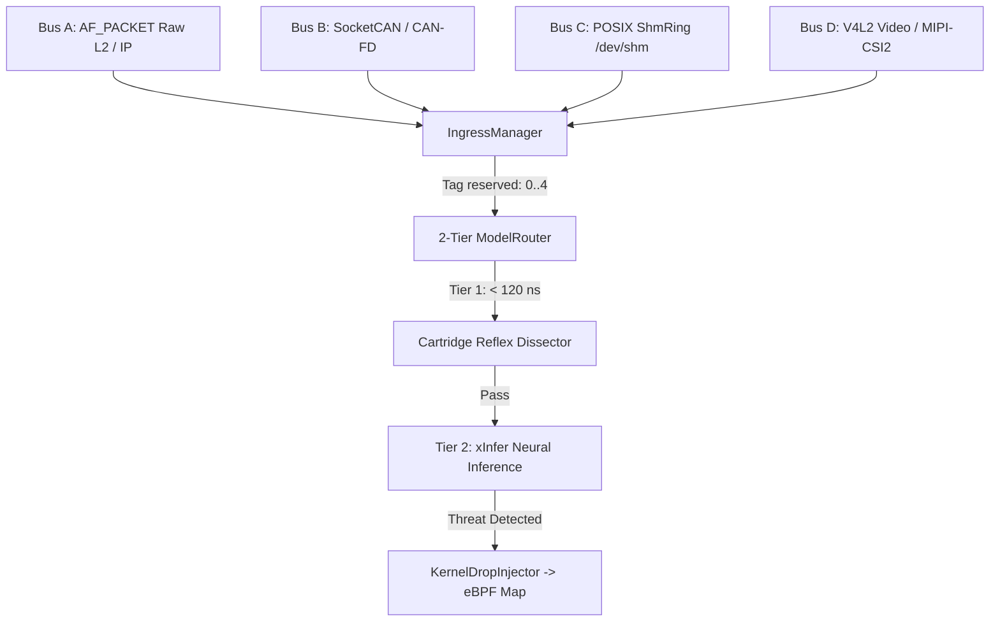

# Multi-Bus Ingress Engine & 2-Tier Cascade ModelRouter

`blackbox-sentinel` is not restricted to standard IP networking. Its core `IngressManager` simultaneously arbitrates traffic across four concurrent physical buses.

---

## 1. The 4 Universal Ingress Buses

* **Bus A (Raw Layer-2 & Ethernet):** `AF_PACKET` (`SOCK_RAW`, `htons(ETH_P_ALL)`) with `SO_TIMESTAMPING` hardware PTP timestamps and `PACKET_OUTGOING` suppression. Parses Non-IP L2 frames (**IEC 61850 GOOSE `0x88B8`**, **SV `0x88BA`**, **EtherCAT `0x88A4`**) directly on the wire.
* **Bus B (Fieldbus CAN / CAN-FD):** Native Linux `AF_CAN` (`vcan0`/`can0`) or Docker `AF_UNIX` datagram bridge (`can://bus0`) receiving standard 16-byte/64-byte `struct can_frame` structures.
* **Bus C (Lock-Free POSIX ShmRing):** Page-aligned 4KB memory slots mapped to `/dev/shm` (`shm://ring0`) with atomic sequence counters, delivering zero-copy IPC transport between container runtimes.
* **Bus D (Optical & Video Ingress):** Linux `V4L2` memory-mapped ring buffer (`/dev/video*`) for real-time camera frames and NIR drowsiness sensors.

---

## 2. 2-Tier Cascade Routing Logic

1. **Tier 1 Reflex Gate (`< 120 ns` SLA):** Evaluates protocol syntax, function codes, monotonic counters, and physical Control Barrier Functions (CBFs). If an invariant is breached (e.g., Modbus FC05 write to an actuator or EtherCAT joint surge > 15 m/s²), the packet is rejected instantly without incurring AI overhead.
2. **Tier 2 Neural Classifier:** Evaluates subtle deviations (such as latent vector reconstruction loss in autoencoders or cross-modal discrepancies between cyber PLC status and physical temperature sensors).
