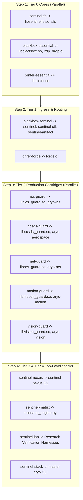

# Master Build Order & Dynamic Linkage DAG (14 Repositories)

To ensure reproducible, zero-circular-dependency compilation across clean air-gapped environments, the Aryorithm ecosystem enforces a strict bottom-up compilation order from Tier 0 to Tier 4.

---

## 1. Topologically Sorted Compilation Sequence

---

## 2. Standard Toolchain Invariants
* **C++ Compiler:** Modern GCC (>= 13.0) or Clang (>= 16.0) supporting `-std=c++20`.
* **Optimization Flags:** `-O3 -march=native -Wall -Wextra -pthread -fno-omit-frame-pointer`.
* **Runtime Pathing (RPATH):** All binaries set `CMAKE_INSTALL_RPATH "/usr/local/lib"` to locate shared ecosystem libraries dynamically without brittle `LD_LIBRARY_PATH` overrides.
* **Kernel Dependencies:** `libbpf-dev`, `libelf-dev`, and `bpftool` for eBPF CO-RE bytecode generation.
