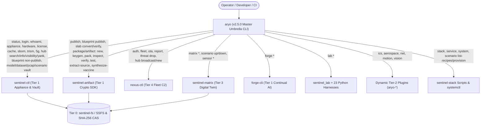
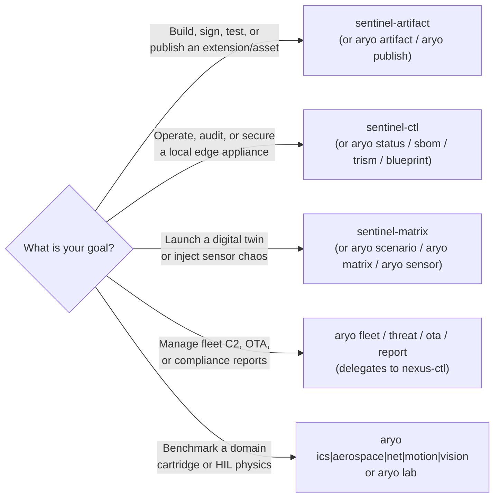

# Master CLI Architecture, Mental Model & Decision Matrix

The Aryorithm Blackbox Sentinel ecosystem exposes a rich command-line surface spanning **~9,700 lines of compiled C++20, Python, and Bash**. Rather than competing tools, the four primary CLIs form a **strict four-tier delegation hierarchy** anchored in Tier 0 (`sentinel-fs` / `sfs`).

---

## 1. The Four-Tool Mental Model

> **Golden Operational Rule:** In daily operations, **start with `aryo`**. You only need to invoke `sentinel-ctl`, `sentinel-artifact`, or `sentinel-matrix` directly when authoring low-level pipelines (`pack-raw`, `.spcap` sealing, or direct `scenario_engine.py` debugging).

| CLI Binary / Script | Tier & Repository | Primary Persona | Core Duty |
| :--- | :--- | :--- | :--- |
| **`aryo`** (`/usr/local/bin/aryo`) | **Tier 4** (`sentinel-stack`) | All Operators & Engineers | **Unified Umbrella Dispatcher (v2.5.0).** Routes 19 built-in domains, 5 dynamic cartridge plugins (`aryo-*`), `systemd` services, `sentinel-lab` harnesses, and `.aryopack` system portability. |
| **`sentinel-ctl`** (`/usr/local/bin/sentinel-ctl`) | **Tier 1** (`blackbox-sentinel`) | Edge Appliance Operator | **Local Appliance & Vault Manager.** Manages Hub authentication (`login`/`whoami`), SSFS cache & USB sneakernet, dependency `sync`/`launch`, TPM 2.0 & commercial licenses, frontier security engines (`5g`, `sbom`, `trism`), and lifecycle management for `blueprint`, `scenario`, `model`, `dataset`, `pcap`, and `package` consumption. |
| **`sentinel-artifact`** (`/usr/local/bin/sentinel-artifact`) | **Tier 1** (`blackbox-sentinel/tools/sdk`) | Extension Developer & Honeynet | **Cryptographic SDK & Universal Publisher.** Scaffolds Tier A/B/C projects (`new`), generates Ed25519 keys (`keygen`), seals 4-way SHA-256 Merkle `.spkg` containers (`pack`/`pack-raw`), verifies/audits/preflight-tests `.spkg` packages, converts/verifies `0x534C4142` SLAB datasets, seals `.spcap` files, synthesizes honeynet vaccines (`synthesize-vaccine`), and uploads all 6 asset classes (`publish`). |
| **`sentinel-matrix`** (`scenario_engine.py`, `sensor_ctl.py`, `matrix_ctl.sh`, `Makefile`) | **Tier 3** (`sentinel-matrix`) | Cyber-Range & Red-Team Engineer | **Digital Twin Orchestrator & Physical Chaos Engine.** Compiles `scenario.yaml` and `pack://` URIs into isolated Docker Compose networks, catalogs and injects `:8088` REST faults across 570+ industrial sensors, and replays malware PCAPs. |
| **`sfs`** (`/usr/local/bin/sfs`) | **Tier 0** (`sentinel-fs`) | Systems Architect | **Sovereign Filesystem Diagnostic Utility.** Initializes canonical SSFS trees, inspects anchor roots, resolves `pack://` URIs, and computes SHA-256 CAS hashes. |

---

## 2. Command Delegation Architecture



---

## 3. Decision Flowchart: *"Which Command Should I Run?"*



---

## 4. Environment Variables & Privilege-Aware SSFS Precedence

All Tier 0–4 utilities linked against `libsentinelfs.so` obey deterministic root resolution with zero hardcoded developer paths:

| Variable / Condition | Effective Path / Behavior |
| :--- | :--- |
| **`SENTINEL_ROOT`** (explicit env var) | Overrides the default SSFS root anchor across `sentinel-ctl`, `sentinel-artifact`, `scenario_engine.py`, and `sfs`. |
| **Root execution (`UID == 0`)** | System production root: `/var/lib/sentinel` (runtime configs & `.spkg` deployed to `/etc/sentinel/`). |
| **Non-root execution (`UID != 0`)** | User sovereign root: `~/.sentinel/` (configs in `~/.sentinel/config/`, scenarios in `~/.sentinel/scenarios/catalog/`). |
| **`SENTINEL_CACHE_DIR`** | Overrides `sentinel-ctl` cache root (default: SSFS `ObjectClass::ArtifactDownload`). |
| **`SENTINEL_HUB_URL`** | Highest-precedence override for the Registry Hub URL, taking priority over `credentials.json` (`hub_url`) and the default `https://backend.aryorithm.com`. |

---

## 5. End-to-End Cross-CLI Operational Playbooks

### Playbook A: Developer-to-Edge `.spkg` Extension Lifecycle
```bash
# 1. Generate Ed25519 developer keypair
aryo artifact keygen ~/.sentinel/pki/certs/developer

# 2. Scaffold a Tier C LuaJIT rule (or 'cpp' / 'rust')
aryo artifact new modbus_coil_guard lua

# 3. Pack, 4-way SHA-256 Merkle sign, inspect, verify, and preflight-test
aryo artifact pack modbus_coil_guard
aryo artifact inspect modbus_coil_guard/modbus_coil_guard.spkg
aryo artifact verify ~/.sentinel/pki/certs/developer_public.pem modbus_coil_guard/modbus_coil_guard.spkg
aryo artifact test modbus_coil_guard/modbus_coil_guard.spkg

# 4. Publish to Hub (auto-signs & attaches manifest) and deploy to edge
aryo publish modbus_coil_guard/modbus_coil_guard.spkg
sudo aryo appliance install modbus_coil_guard/modbus_coil_guard.spkg
aryo status
```

### Playbook B: Digital Twin Scenario -> Bare-Metal Production Blueprint
```bash
# 1. Discover and provision one of the 50 turnkey recipes
aryo scenario list-recipes
aryo scenario provision 05_drinking_water_dosing_guard --up

# 2. Validate live twin, then tear down simulation mesh
aryo matrix status
aryo scenario down 05_drinking_water_dosing_guard

# 3. Convert the validated scenario into a bare-metal production blueprint
sentinel-ctl blueprint from-scenario 05_drinking_water_dosing_guard \
  --site WaterPlant-North-01 --interface ens160 --af-xdp ZEROCOPY

# 4. Inspect hardware bindings and atomically deploy (< 2 ms RCU swap)
aryo blueprint inspect bp_05_drinking_water_dosing_guard
sudo aryo blueprint deploy bp_05_drinking_water_dosing_guard
# Emergency instant rollback if required:
sudo aryo blueprint rollback
```

### Playbook C: Air-Gapped USB Sneakernet Transfer
```bash
# On internet-connected staging host:
aryo cache export /tmp/offline_sentinel_cache.tar.gz
sudo aryo system export /tmp/sentinel_ecosystem.aryopack

# On isolated air-gapped facility server:
aryo cache import /tmp/offline_sentinel_cache.tar.gz
aryo appliance check /etc/sentinel/model_routes.yaml
aryo appliance launch /etc/sentinel/model_routes.yaml
```

### Playbook D: Autonomous Honeynet Vaccine Synthesis & Immunization
```bash
# 1. Harvest exploit JSON from decoy spool, synthesize LuaJIT .spkg, and preflight-test
aryo artifact synthesize-vaccine /var/run/sentinel/honeynet_spool /tmp/honeynet_vaccines

# 2. Share to collective threat feed and broadcast fleet-wide (< 50 ms)
aryo threat vaccine-share /tmp/honeynet_vaccines/vaccine_*/vaccine_*.spkg
aryo threat vaccine-feed 20

# Or run the entire closed-loop harvest + broadcast in a single command:
aryo matrix honeynet-autohunt
```

---

## 6. Tier 0 Diagnostic Utility: `sfs`

Compiled from `sentinel-fs` (`/usr/local/bin/sfs`), `sfs` inspects the foundational storage and SHA-256 CAS layer:

```bash
sfs init                       # Initialize canonical SSFS directory hierarchy
sfs status                     # Display authoritative anchor roots and UID mode
sfs resolve pack://ics-guard/web   # Resolve symbolic cartridge pack:// URI
sfs cas-hash <path-to-file>    # Compute OpenSSL EVP SHA-256 content-addressable digest
```

---

## 7. Automated One-by-One CLI Verification Suite (95/95 Verified)

To verify every command individually inside isolated `/tmp` sandboxes (zero impact on live `~/.sentinel` or `/etc/sentinel` directories), execute the modular verification suite located in `/home/kami/sentinel-stack/tests/cli_verification/`:

```bash
# Run all 95 command-by-command tests across all 4 toolchains
bash /home/kami/sentinel-stack/tests/cli_verification/run_all_cli_tests.sh

# Test a single toolchain with verbose command output
bash /home/kami/sentinel-stack/tests/cli_verification/run_all_cli_tests.sh --tool aryo --verbose
bash /home/kami/sentinel-stack/tests/cli_verification/run_all_cli_tests.sh --tool artifact
bash /home/kami/sentinel-stack/tests/cli_verification/run_all_cli_tests.sh --tool ctl
bash /home/kami/sentinel-stack/tests/cli_verification/run_all_cli_tests.sh --tool matrix
```

> **Note:** Full-stack, backend-connected integration tests (requiring live Hub JWT sessions and Docker) remain separately organized in `/home/kami/sentinel-stack/tests/e2e/run_all_e2e_tests.sh` (55 suites).

---

## 8. Dedicated Tool Manuals
* **[CLI Manual: `aryo` (Master Umbrella CLI)](03-aryo-master-cli.md)**
* **[CLI Manual: `sentinel-ctl` (Appliance Operator & Vault)](04-sentinel-ctl-manual.md)**
* **[CLI Manual: `sentinel-artifact` (Cryptographic SDK & Publisher)](05-sentinel-artifact-sdk.md)**
* **[CLI Manual: `sentinel-matrix` (Digital Twin & Sensor Chaos)](06-sentinel-matrix-cli.md)**
