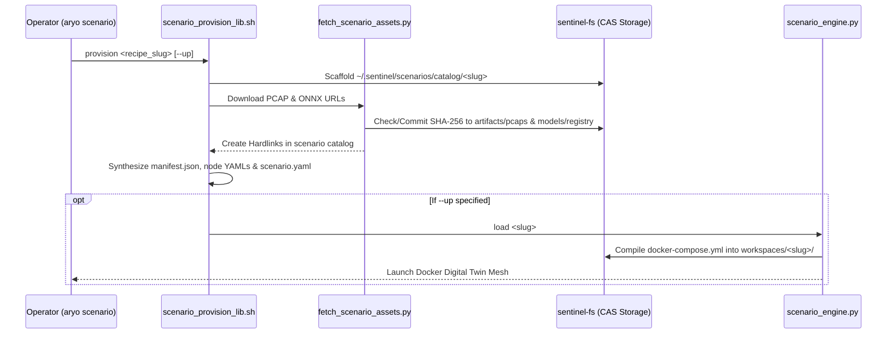

# The 50-Recipe Scenario Catalog & Provisioning Engine

The Aryorithm scenario catalog delivers **50 turnkey, production-grade cyber-physical digital twin scenarios** spanning 5 industrial sectors. Every scenario runs on an isolated `/24` subnet with zero external dependencies.

---

## 1. Autonomous Provisioning Architecture

Scenarios are provisioned outside version-controlled git trees via `scenario_provision_lib.sh` and `fetch_scenario_assets.py`:



---

## 2. Exemplary Catalog Recipes

```text
┌──────┬────────────────────────────────────┬──────────────┬──────────────────┬──────────────────────────┐
│ Slug │ Scenario Title                     │ Cartridge    │ Subnet           │ Verified Defense Vector  │
├──────┼────────────────────────────────────┼──────────────┼──────────────────┼──────────────────────────┤
│ 01   │ Substation Busbar Trip Shield      │ ics-guard    │ 10.240.101.0/24  │ IEC-104 Spurious Trip    │
│ 02   │ S7 PLC Firmware Runaway Guard      │ ics-guard    │ 10.240.102.0/24  │ S7Comm CPU STOP 0x29     │
│ 05   │ Drinking Water Chemical Dosing     │ ics-guard    │ 10.240.105.0/24  │ Modbus Tampered Setpoint │
│ 11   │ Tactical UAV STANAG Interceptor    │ ccsds-guard  │ 10.240.111.0/24  │ DLI Telecommand Checksum │
│ 21   │ 5G UPF URLLC Slice Air-Gap         │ net-guard    │ 10.240.121.0/24  │ GTP-U Slice-Hopping Drop │
│ 31   │ Industrial Cobot EtherCAT Clamp    │ motion-guard │ 10.240.131.0/24  │ Joint Accel Surge Clamp  │
│ 43   │ HIPAA RAM-Only Surgical ToF Guard  │ vision-guard │ 10.240.143.0/24  │ 0B Disk Egress ShmRing   │
└──────┴────────────────────────────────────┴──────────────┴──────────────────┴──────────────────────────┘
```

### Provisioning & Lifecyle Commands
```bash
# Provision and launch recipe 05 directly
aryo scenario provision 05_drinking_water_dosing_guard --up

# Query running digital twin containers
docker ps --filter "name=matrix-"

# Dismantle digital twin cleanly with zero orphans
aryo scenario down 05_drinking_water_dosing_guard
```
