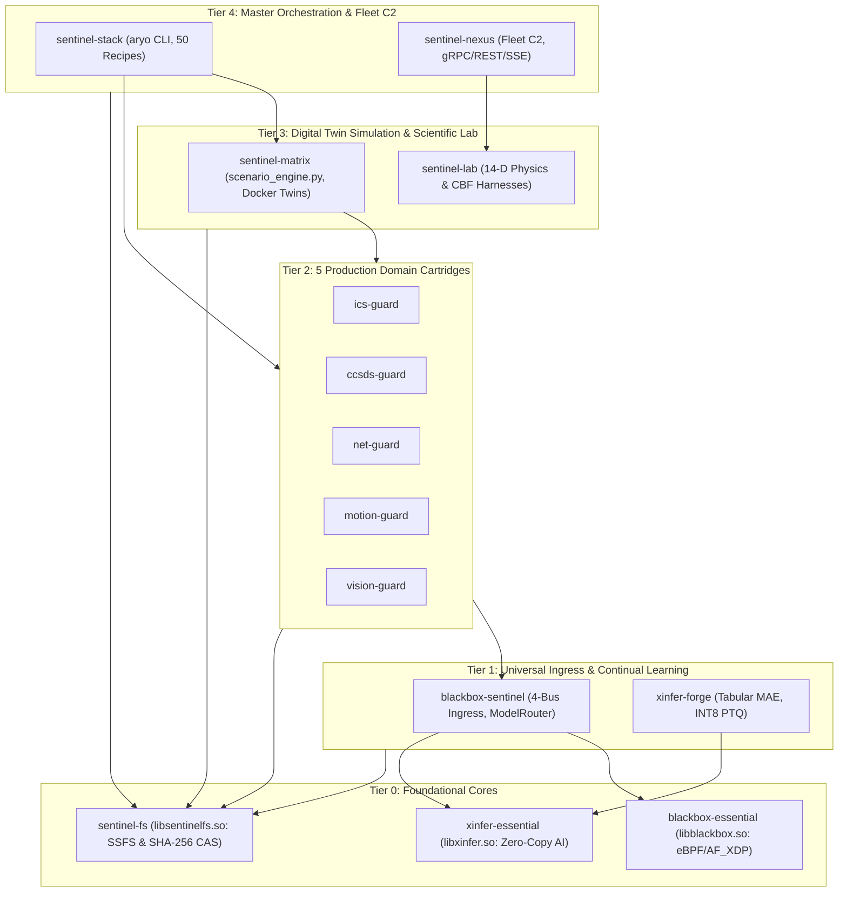

# Aryorithm Technologies B.V. — Blackbox Sentinel Ecosystem

**Corporate Entity:** Aryorithm Technologies B.V. (Amsterdam, The Netherlands)  
**Founder & CTO:** Kamran Saberifard (`github.com/kamisaberi`)  
**Peer-Reviewed Preprint DOI:** CERN / Zenodo `10.5281/zenodo.23598779`  

---

## What Is Blackbox Sentinel?

Blackbox Sentinel is a **deterministic, zero-egress cyber-physical defense platform** engineered to protect critical infrastructure—power substations, autonomous UAV swarms, 5G telecom slices, surgical robotics, and air-gapped industrial vision—in **sub-microsecond latency bounds**.

Unlike cloud-dependent SIEMs or signature-only firewalls, Sentinel fuses:
1. **In-Kernel eBPF/XDP Drops (`< 0.84 µs`)** at `10.25M–40M+` events per second.
2. **Sub-120 ns Physical Safety & Protocol Gates** (`11.96 ns` to `26.60 ns` mean) grounded in Control Barrier Functions (Ames/Nagumo CBFs) and Runge-Kutta 4th-Order ODEs.
3. **Hardware-Accelerated Edge AI (`libxinfer.so`)** with continual self-supervised adaptation (`xinfer-forge`).
4. **Sovereign Air-Gapped Operation (`$0.00` Cloud Egress)** anchored in physical **TPM 2.0** silicon roots.

---

## How the 14 Repositories Connect (5-Tier Architecture)

